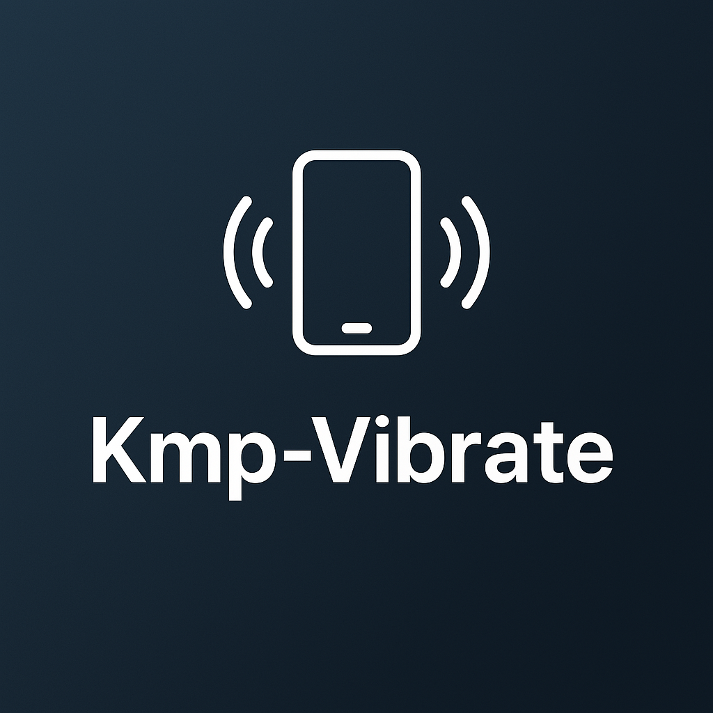

# KMP Vibrate

Kotlin Multiplatform utility library for vibrate📱!


## How to Install

In `lib.versions.toml`  include this dependency version catalog

```toml
[versions]
vibrate = "1.2.0"

[libraries]
vibrate = { module = "io.github.jmseb3:vibrate", version.ref = "vibrate" }
```

```kotlin
commonMain.dependencies {
    implementation(libs.vibrate)
}
```

or In `build.gradle` of app module, include this dependency

```gradle
commonMain.dependencies {
    implementation("io.github.jmseb3:vibrate:1.2.0")
}
```

## Sample App

Example app source lives in [`sample/`](sample).

- JS browser: `./gradlew :sample:webApp:jsBrowserDevelopmentRun --continue`
- WASM browser: `./gradlew :sample:webApp:wasmJsBrowserDevelopmentRun --continue`
- Android: run `sample:androidApp` from Android Studio
- iOS: open `sample/iosApp/iosApp.xcodeproj` in Xcode and run

## How To Use Vibrate

Use Kotlin `Duration` for playback times. The legacy numeric APIs interpret
durations as milliseconds, except for `vibrateSecond()`.

### Check Support

```kotlin
import com.wonddak.vibrate
import kotlin.time.Duration.Companion.milliseconds

if (VibratorManager.isSupported()) {
    VibratorManager.vibrate(300.milliseconds)
}
```

### Capabilities

```kotlin
import com.wonddak.vibrate
import kotlin.time.Duration.Companion.milliseconds

val capabilities = VibratorManager.capabilities()
if (capabilities.isSupported) {
    VibratorManager.vibrate(300.milliseconds)
}
// Use capabilities.supportsAmplitudeControl to enable strength controls in your UI.
```

- `isSupported` matches `VibratorManager.isSupported()`.
- Android reports amplitude control only on API 26+ devices with hardware support.
- iOS reports amplitude control when Core Haptics is supported.
- JS/Wasm always report amplitude control as unsupported.

These values describe available features, not guaranteed playback. On the web,
support only means the browser exposes the Vibration API; hardware, user activation,
user settings, and browser policies may still prevent vibration.

### One Time

```kotlin
import com.wonddak.vibrate
import kotlin.time.Duration.Companion.milliseconds
import kotlin.time.Duration.Companion.seconds

VibratorManager.vibrate(3.seconds)
VibratorManager.vibrate(300.milliseconds, strength = 0.5f)
```

Durations are truncated to whole milliseconds. Infinite durations and values below 1 ms are ignored.

`vibrate(Long)` and `vibrateSecond(Int)`, including their strength overloads,
are deprecated with warnings in 1.2.0. Convert milliseconds with `.milliseconds`
and seconds with `.seconds` before calling `vibrate()`.

### Strength

```kotlin
import com.wonddak.vibrate
import kotlin.time.Duration.Companion.seconds

VibratorManager.vibrate(3.seconds, strength = 0.5f)
VibratorManager.vibrate(
    VibrationPreset.Success,
    strength = 0.8f
)
```

`strength` uses a normalized `0f..1f` range. Zero, negative, and NaN values do not start playback.

- Android maps it to vibration amplitude.
- iOS maps it to Core Haptics intensity.
- JS/Wasm use the browser's default strength for valid positive values.

### Pattern

Each `VibrationSegment` specifies a delay followed by a vibration:

```kotlin
import com.wonddak.model.VibrationSegment
import kotlin.time.Duration.Companion.milliseconds

VibratorManager.vibrateSegments(
    listOf(
        VibrationSegment(duration = 80.milliseconds),
        VibrationSegment(duration = 120.milliseconds, delay = 60.milliseconds)
    )
)
```

`VibratePattern` and the numeric and typed `vibratePattern()` overloads are
deprecated with warnings in 1.2.0. Convert each legacy `[delay, vibrate]` pair
to a segment using `.milliseconds`, then call `vibrateSegments()`. To keep a
shared strength, pass the same `strength` to every segment.

### Presets

Built-in presets are available through `VibrationPreset`.

```kotlin
VibratorManager.vibrate(VibrationPreset.Success)
VibratorManager.vibrate(VibrationPreset.Error)
```

Available presets:

- `VibrationPreset.Success`
- `VibrationPreset.Click`
- `VibrationPreset.DoubleClick`
- `VibrationPreset.Tick`
- `VibrationPreset.Warning`
- `VibrationPreset.Error`
- `VibrationPreset.Heartbeat`
- `VibrationPreset.Sos`

If you want to inspect or customize a preset, you can also read its pattern list:

```kotlin
val successSegments = VibrationPreset.Success.segments
val successDuration = VibrationPreset.Success.durationMillis
```

### UI Feedback

```kotlin
VibratorManager.feedback(HapticFeedback.SelectionChanged)
VibratorManager.feedback(HapticFeedback.Click)
VibratorManager.feedback(HapticFeedback.Success)
```

iOS uses UIKit selection, impact, and notification feedback. Android 29+ uses
system effects for selection and click. Android uses timing presets for the
other events and on older versions. JS/Wasm use timing presets for all events.

### Repetition and Per-Segment Strength

```kotlin
import com.wonddak.model.VibrationSegment
import com.wonddak.vibrate
import kotlin.time.Duration.Companion.milliseconds

VibratorManager.vibrate(VibrationPreset.Success, repeatCount = 3)
VibratorManager.vibrateSegments(
    listOf(
        VibrationSegment(60.milliseconds, strength = 0.3f),
        VibrationSegment(90.milliseconds, strength = 1f, delay = 80.milliseconds)
    ),
    repeatCount = 2
)
```

The repeat count is the total number of plays (1 to 100), and each play includes
the initial delay.
Repeated patterns expand to at most 10,000 pulses. An invalid segment discards
the request. Targets without amplitude control play the same timings at their
default strength.

Core Haptics caps each vibration pulse at 30 seconds. Web timing values greater
than `Int.MAX_VALUE` milliseconds are ignored, and browsers may shorten or truncate
valid patterns. `stopVibrate()` cancels pattern playback, including a pending web
delay. UIKit feedback consists of short system effects without a stop control.

### Stop

```kotlin
VibratorManager.stopVibrate()
```


### In Kotlin/Js Or Kotlin/Wasm
This feature is supported by the Vibrate API.

For more detailed information, please refer to the official documentation:

[Vibrate Api](https://developer.mozilla.org/en-US/docs/Web/API/Vibration_API)
